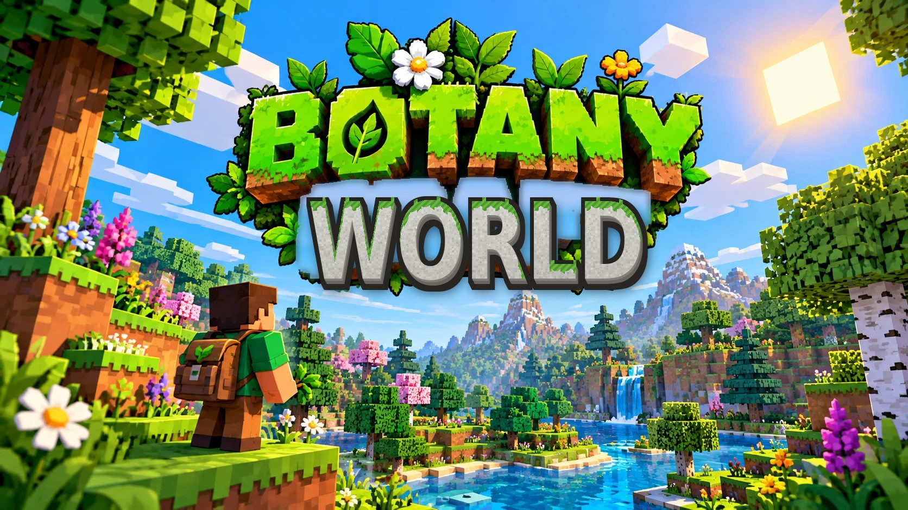

# Botany World

A block-world game that teaches botany. Explore six real Earth biomes laid out on a climate map (cold north, hot south, dry west, wet east), dig into the soil to read its horizons, gather seeds from wild plants, and grow them where they belong. Everything you meet goes into a Field Journal, and 17 quests with quiz questions walk you through the science.

Runs in any modern browser on Mac, Windows, Linux, iPhone and Android. No install, no build step.

## Play

* **Hosted:** enable GitHub Pages for this repository (Settings → Pages → Source: *GitHub Actions*). The included workflow publishes the site on every push to `master`.
* **Locally:** open `index.html` in a browser, or serve the folder (`npx http-server .`) and visit the printed URL.

## Playing together

The start screen has a *Play together* form. One person creates a shared world with a name and a PIN; everyone else joins with the same name and PIN from any device. The land, soil and plants are shared and saved to the cloud (Supabase). Each player keeps their own journal, quests and inventory. Players online at the same time see each other as avatars, and the first player in the room hosts the simulation (growth, animals, weather) for everyone. If the host leaves, the next player takes over automatically.

The backend is a Supabase project: two tables (`bc_worlds`, `bc_players`) behind PIN-checked database functions, plus Realtime broadcast channels for live play. The public key in `js/config.js` only grants access through those functions.

## What it teaches

| Topic | In the game |
|---|---|
| Soil science | 11 soil types based on USDA soil orders (Alfisol, Mollisol, Aridisol, Oxisol, Spodosol, Histosol, Gelisol permafrost, gley, compost, caliche, bedrock), each with real horizons, pH, texture, drainage and where on Earth it occurs. Dig down to see the profile. |
| Plant requirements | 148 plants and 78 trees (48 of them fruit and nut trees, from apple to starfruit, almond to pecan), including the 50 most-grown vegetable, fruit and nut crops in the United States by USDA acreage with real soil, pH, water, light and climate needs. The growth simulation scores all five every tick and explains exactly why a plant is thriving or withering. |
| Biogeography | A world 896 blocks across with seven biomes, from Arctic tundra with permafrost, snow and frozen lakes to tropical rainforest, with their real-world locations, climate and native species. A world map shows how temperature and rainfall decide the biome. |
| Ecology | Nitrogen fixation (legumes), pollination (bees, butterflies, hummingbirds visit your flowers and double seed yield), herbivory (deer and hares eat unfenced crops), invasive species, epiphytes, carnivorous plants, succession, fire ecology, composting, the Three Sisters. |
| Animals | 125 animals, including 45 birds, each placed only in its real habitat and each with its role in the ecosystem. Every player owns an enchanted horse, called with the bridle in the starting bag, that carries only its owner and wears their initial. Horses, donkeys, camels, elk, bison, moose and caribou can be ridden, and a wagon hitched to one carries you and your cargo. |
| Landmarks | A tenth-scale Giza pyramid complex hidden in the desert, Machu Picchu on a northern ridge, and Atlantis as Plato described it: a ring city in a bay at the edge of the sea, with a drowned quarter. Sail 160 blocks past any edge of the map and the ocean wraps you to the far side. |
| Firefly mode | A menu toggle: from dusk to dawn hundreds of fireflies drift and blink around you and the whole night lifts to a soft green-gold glow, nearly as bright as day. |
| Building | Craft kits that raise a 7 by 7 koi pond (stone rim, puddled-clay liner, water lilies, six koi) or a solar greenhouse (glass, solar panel, pump). A Carpentry tab cuts 20 shapes from planks: upper slab, timber post, porch column, timber-frame wall, clapboard siding, floor hatch, beam, porch railing, window shutters, roof slope, roof ridge, awning, log cabin wall, wainscot, kitchen cupboard, split-rail fence, pergola rafters, arch top, corner boards and balcony. Villages are built from them: log cabins in the north, timber frame in the temperate belt, clapboard on the prairie, with shutters, shingled roof slopes, ridges and awnings. |
| Minerals | Gold, silver and copper ore seed the bedrock; smelt four ore with charcoal for a solid gold, silver or copper block, and weather copper with mineral salts into blue-green verdigris, the same copper salt as Bordeaux mixture. |

## Controls

Desktop: WASD to move, mouse to look (click to capture), left click to use or harvest, right click to inspect, 1 to 9 or mouse wheel for tools and seeds, J journal, Q quests, M map, Esc menu.

Phone: left thumb drags to move, right thumb drags to look, tap to use, press and hold to inspect. Jump and Run buttons bottom right.

## Code layout

* `js/data/` botanical content (148 plants, 78 trees, 125 animals): soils, biomes, plants, trees, animals, quests and quizzes.
* `js/textures.js` procedural pixel-art atlas (blocks and plant sprites), drawn at load time.
* `js/world.js` terrain, climate map, soil horizons, trees and wild plants.
* `js/mesher.js` chunk meshes with ambient occlusion, water and plant sprites.
* `js/sim.js` growth simulation and plant diagnosis.
* `js/player.js`, `js/animals.js`, `js/ui.js`, `js/main.js` controls, creatures, interface and game loop.

Rendering uses [three.js](https://threejs.org/) from a CDN. Progress saves to the browser's local storage.
